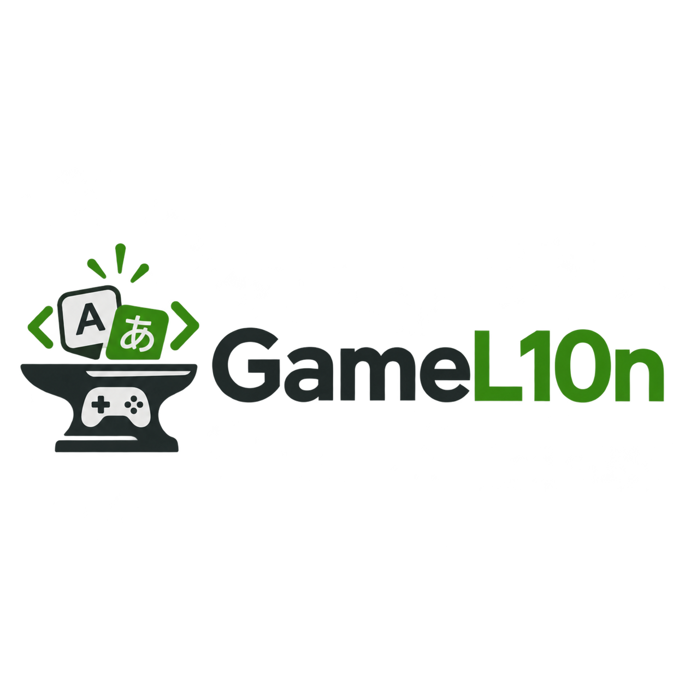

  
  <h1>GameL10n</h1>
  
<strong>面向 Windows 的游戏文本汉化补丁制作桌面工具</strong>

  
内置常见引擎适配器，并支持通过 LLM 自动识别与动态适配未知资源格式

  

    <a href="https://github.com/shoaky009/GameL10n/releases">下载发行包</a> ·
    <a href="docs/model-providers.md">模型配置</a> ·
    <a href="docs/README.md">全部文档</a> ·
    <a href="CHANGELOG.md">更新日志</a>
  

---

## 核心特性

- **全程内置，开箱即用**：游戏识别与智能适配均在软件内完成，配好模型 API、选定游戏目录即可开工。
- **优先复用 + AI 动态适配**：自动匹配现有适配器；遇到未收录的引擎或资源格式时，可调用 LLM 尝试编写并验证新适配器。
- **先试译，再全量**：支持自动安装试译补丁、启动游戏并检查译文显示效果，确认无误后再生成全量补丁，避免返工。

---

## 快速开始

1. **下载运行**  
   前往 [GitHub Releases](https://github.com/shoaky009/GameL10n/releases) 下载 Windows x64 发行包，**完整解压**后运行 `GameL10n.exe`。

2. **配置模型**  
   在 **模型配置** 中接入远程 API 或本地翻译服务。如需使用智能适配功能，请额外配置支持工具调用（Tool Calling）的分析模型。  
   详见 [模型接口配置](docs/model-providers.md)。

3. **识别游戏**  
   点击 **添加游戏** 选择游戏安装目录 → 进入 **识别与适配** → 在 **本次目标** 中选择 **识别游戏** 并开始识别。

4. **试译与出包**  
   在 **翻译与校对** 中挑选几句易定位的文本，依次点击 **生成补丁** 和 **安装补丁**。进入游戏确认译文正常显示后，再进行全量翻译与制作。  
   详见 [桌面操作指南（从识别到试译）](docs/desktop.md#从识别到试译)。

---

## 文档导航

| 文档 | 说明 |
| :--- | :--- |
| [支持的引擎与资源格式](docs/adapters/README.md) | 查看已内置的适配器列表（未收录格式可通过 LLM 自动识别并动态适配） |
| [模型接口配置](docs/model-providers.md) | 远程 API、本地翻译及分析模型的配置方法 |
| [桌面操作指南](docs/desktop.md#从识别到试译) | 从游戏识别、试译验证到全量出包的完整流程 |
| [开发与构建](docs/development.md) | 本地开发环境搭建与源码编译说明 |
| [更新日志](CHANGELOG.md) | 各版本功能变更与修复记录 |
| [全部文档](docs/README.md) | 完整文档索引 |

---

## 常见问题

**Windows 上提示“执行隔离未能启动”怎么办？**

当系统环境无法启动 AppContainer 时会出现该提示。请按以下路径关闭隔离后重试：

> **程序设置** → 取消勾选 **LLM 执行隔离** → 点击 **保存程序设置**

---

## 使用范围与免责声明

> [!IMPORTANT]
> 本项目为独立开发的**非官方工具**，不代表任何游戏开发商、发行商、引擎作者或平台，亦未获得其认可或背书。文中提及的游戏、引擎及平台名称仅用于说明兼容性，相关权利归各自权利人所有。

- **合法使用**：请仅在取得必要授权或适用法律允许的范围内处理游戏资源。
- **权利边界**：购买游戏或获取本工具的开源许可，不代表获得游戏内容的翻译、修改或传播授权。
- **相关入口**：使用前请阅读 [免责声明与使用边界](DISCLAIMER.md)；如有版权问题，请通过 [版权投诉入口](https://github.com/shoaky009/GameL10n/issues/new?template=copyright.yml) 联系维护者。

---

## 开源许可

- 主程序采用 [GPL-3.0-only](LICENSE) 许可协议，允许在遵守条款的前提下使用、修改及分发（含商业用途），分发时须履行源码提供及许可保留义务。
- 独立组件与第三方材料保留其各自许可，详见 [许可声明](THIRD-PARTY-NOTICES.md)。
- 软件许可不授予任何第三方游戏内容或商标权利。